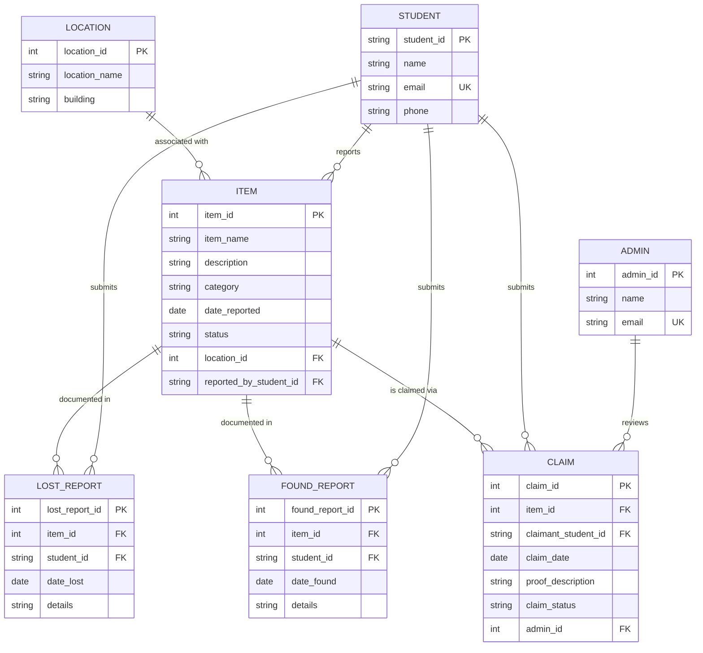

# VELLORE INSTITUTE OF TECHNOLOGY
### School of Computer Science Engineering and Information Systems (SCORE)
### BCSE302L – Database Systems | Laboratory Course Project Report

---

# CAMPUS LOST AND FOUND MANAGEMENT SYSTEM
**A Relational Database and PL/SQL Application for Campus Item Recovery**

---

### Student & Project Details
* **Student Name:** Arahat Gaikwad
* **Registration Number:** 24BYB0182
* **Course Code & Title:** BCSE302L – Database Systems
* **Degree / Branch:** B.Tech Computer Science & Engineering
* **Institution:** Vellore Institute of Technology (VIT), Vellore
* **Database Platform:** Oracle Database 19c/21c & SQLite Embedded Engine
* **Demonstration Interface:** Python 3 Interactive Application

---

## TABLE OF CONTENTS
1. [Project Title and Team/Student Details](#1-project-title-and-student-details)
2. [Introduction and Problem Statement](#2-introduction-and-problem-statement)
3. [Functional Requirements (FR1 – FR15)](#3-functional-requirements)
4. [Entity-Relationship (ER) Diagram & Cardinality Mapping](#4-entity-relationship-er-diagram)
5. [Relational Schema and Normalization (3NF)](#5-relational-schema)
6. [Table Creation DDL and Integrity Constraints](#6-table-creation-and-constraints)
7. [Comprehensive SQL Queries and Outputs](#7-sql-queries-and-outputs)
8. [PL/SQL Components (Procedures, Functions, Cursor, Triggers)](#8-plsql-components)
9. [Real-World Transaction Demonstrations (End-to-End Flow)](#9-real-world-transaction-demonstrations)
10. [Conclusion and Future Enhancements](#10-conclusion-and-future-enhancements)

---

## 1. PROJECT TITLE AND STUDENT DETAILS

* **Project Title:** Campus Lost and Found Management System
* **Primary Developer:** Arahat Gaikwad (24BYB0182)
* **Domain:** University Campus Administration, Student Services & Asset Tracking
* **Target Users:** Students, Campus Security Officers, Hostel Wardens, Central Library Staff, Estate Office

---

## 2. INTRODUCTION AND PROBLEM STATEMENT

### 2.1 Overview of the Campus Challenge
On a bustling collegiate campus like VIT with over 40,000 students and staff, hundreds of personal items—including student identity cards, scientific calculators, laptops, chargers, headphones, wallets, and room keys—are misplaced daily in lecture halls (SJT, TT, PRP), reading rooms, libraries, auditoriums, mess halls, and sports complexes.

Currently, the recovery process is informal, highly fragmented, and inefficient:
1. **Scattered & Duplicate Records:** Physical registers maintained separately across campus gates, hostel warden offices, and libraries lead to zero centralized visibility.
2. **Unverified or False Claims:** Lack of documented proof and formal verification allows unauthorized claimants to falsely retrieve high-value electronics.
3. **Low Recovery Rates:** Students whose items are found have no real-time mechanism to match their lost reports against found inventories.
4. **No Lifecycle Tracking:** No mechanism exists to calculate unclaimed periods or flag items needing disposal or auction.

### 2.2 Proposed Solution
The **Campus Lost and Found Management System** is a unified, database-driven application built upon relational database principles, SQL, and PL/SQL. It establishes:
* A single, normalized database cataloging all lost and found incident reports.
* Strict relational integrity ensuring every item links to an authenticated student and a verified campus location.
* Structured claim verification workflows with automated status progression (`LOST` / `FOUND` → `CLAIMED` → `RETURNED`).
* Business rule automation using stored procedures, functions, explicit cursors, and triggers.

---

## 3. FUNCTIONAL REQUIREMENTS

The application implements 15 core functional requirements:

| Requirement ID | Requirement Name | Description |
| :--- | :--- | :--- |
| **FR1** | Student Management | Register, update, and maintain student identity profiles with unique institutional emails. |
| **FR2** | Admin & Security Management | Register campus security personnel, library staff, and hostel wardens authorized to verify claims. |
| **FR3** | Location Directory | Catalog official campus zones, blocks, buildings, and classroom numbers. |
| **FR4** | Lost Item Reporting | Permit registered students to file detailed reports for misplaced personal articles. |
| **FR5** | Found Item Reporting | Enable discoverers to turn in found items with precise pickup location and time. |
| **FR6** | Multi-Criteria Item Search | Search catalog by keyword, item category, campus building, or date ranges. |
| **FR7** | Ownership Claim Submission | Allow students to submit formal claims with detailed proof of ownership (serials, unique marks). |
| **FR8** | Administrative Claim Verification | Review submitted evidence and formally record an `APPROVED` or `REJECTED` decision. |
| **FR9** | Automatic Status Progression | Automatically transition item status to `RETURNED` upon administrative claim approval. |
| **FR10** | Integrity Violation Prevention | Automatically block subsequent claims on items that have already been resolved and returned. |
| **FR11** | Unclaimed Age Calculation | Dynamically compute elapsed calendar days an item remains unresolved in the system. |
| **FR12** | Batch Bulk Cursor Audit | Scan and flag aged, unclaimed items exceeding a configurable aging threshold. |
| **FR13** | Student Status Tracking | Provide real-time claim status feedback (`PENDING`, `APPROVED`, `REJECTED`) to students. |
| **FR14** | Analytical Reporting | Generate aggregate incident frequencies, building hotspots, and officer decision summaries. |
| **FR15** | DML Auditing & Demonstration | Complete execution of INSERT, UPDATE, and DELETE operations with integrity preservation. |

---

## 4. ENTITY-RELATIONSHIP (ER) DIAGRAM

The system architecture consists of **7 entities** interconnected via **9 One-to-Many ($1:N$) relationships**.

### 4.1 Cardinality & Foreign Key Mapping Table

| Parent Entity ($1$) | Child Entity ($N$) | Foreign Key in Child | Cardinality | Semantic Meaning |
| :--- | :--- | :--- | :---: | :--- |
| **STUDENT** | **ITEM** | `reported_by_student_id` | $1 : N$ | A student reports zero, one, or many items. |
| **LOCATION** | **ITEM** | `location_id` | $1 : N$ | A location is associated with multiple reported items. |
| **STUDENT** | **LOST_REPORT** | `student_id` | $1 : N$ | A student files zero or more lost incident reports. |
| **ITEM** | **LOST_REPORT** | `item_id` | $1 : N$ | A lost report references a specific cataloged item. |
| **STUDENT** | **FOUND_REPORT** | `student_id` | $1 : N$ | A student files zero or more found incident reports. |
| **ITEM** | **FOUND_REPORT** | `item_id` | $1 : N$ | A found report references a specific cataloged item. |
| **STUDENT** | **CLAIM** | `claimant_student_id` | $1 : N$ | A student submits zero, one, or multiple claims. |
| **ITEM** | **CLAIM** | `item_id` | $1 : N$ | An item may receive zero, one, or competing claims. |
| **ADMIN** | **CLAIM** | `admin_id` | $1 : N$ | An admin reviews and adjudicates multiple claims. |

### 4.2 Mermaid Structural ER Diagram



---

## 5. RELATIONAL SCHEMA

All tables are in **Third Normal Form (3NF)**:
1. **1NF:** All attribute values are atomic; no repeating groups exist.
2. **2NF:** Every non-prime attribute is fully functionally dependent on the entire primary key (no partial dependencies).
3. **3NF:** No non-prime attribute is transitively dependent on any candidate key ($X \rightarrow Y$ only where $X$ is a superkey).

### Schema Notation:
* **LOCATION** (<ins>location_id</ins>, location_name, building)
* **STUDENT** (<ins>student_id</ins>, name, email [UNIQUE], phone)
* **ADMIN** (<ins>admin_id</ins>, name, email [UNIQUE])
* **ITEM** (<ins>item_id</ins>, item_name, description, category, date_reported, status, location_id [FK $\rightarrow$ LOCATION], reported_by_student_id [FK $\rightarrow$ STUDENT])
* **LOST_REPORT** (<ins>lost_report_id</ins>, item_id [FK $\rightarrow$ ITEM], student_id [FK $\rightarrow$ STUDENT], date_lost, details)
* **FOUND_REPORT** (<ins>found_report_id</ins>, item_id [FK $\rightarrow$ ITEM], student_id [FK $\rightarrow$ STUDENT], date_found, details)
* **CLAIM** (<ins>claim_id</ins>, item_id [FK $\rightarrow$ ITEM], claimant_student_id [FK $\rightarrow$ STUDENT], claim_date, proof_description, claim_status, admin_id [FK $\rightarrow$ ADMIN, Nullable])

---

## 6. TABLE CREATION AND CONSTRAINTS (DDL)

```sql
-- 1. LOCATION TABLE
CREATE TABLE LOCATION (
    location_id     NUMBER(6)       NOT NULL,
    location_name   VARCHAR2(100)   NOT NULL,
    building        VARCHAR2(100)   NOT NULL,
    CONSTRAINT pk_location PRIMARY KEY (location_id)
);

-- 2. STUDENT TABLE
CREATE TABLE STUDENT (
    student_id      VARCHAR2(20)    NOT NULL,
    name            VARCHAR2(100)   NOT NULL,
    email           VARCHAR2(100)   NOT NULL,
    phone           VARCHAR2(20)    NOT NULL,
    CONSTRAINT pk_student PRIMARY KEY (student_id),
    CONSTRAINT uk_student_email UNIQUE (email)
);

-- 3. ADMIN TABLE
CREATE TABLE ADMIN (
    admin_id        NUMBER(6)       NOT NULL,
    name            VARCHAR2(100)   NOT NULL,
    email           VARCHAR2(100)   NOT NULL,
    CONSTRAINT pk_admin PRIMARY KEY (admin_id),
    CONSTRAINT uk_admin_email UNIQUE (email)
);

-- 4. ITEM TABLE
CREATE TABLE ITEM (
    item_id                 NUMBER(8)       NOT NULL,
    item_name               VARCHAR2(100)   NOT NULL,
    description             VARCHAR2(400),
    category                VARCHAR2(50)    NOT NULL,
    date_reported           DATE            DEFAULT SYSDATE NOT NULL,
    status                  VARCHAR2(20)    DEFAULT 'LOST' NOT NULL,
    location_id             NUMBER(6)       NOT NULL,
    reported_by_student_id  VARCHAR2(20)    NOT NULL,
    CONSTRAINT pk_item PRIMARY KEY (item_id),
    CONSTRAINT fk_item_location FOREIGN KEY (location_id)
        REFERENCES LOCATION(location_id),
    CONSTRAINT fk_item_student FOREIGN KEY (reported_by_student_id)
        REFERENCES STUDENT(student_id),
    CONSTRAINT chk_item_status CHECK (status IN ('LOST', 'FOUND', 'CLAIMED', 'RETURNED'))
);

-- 5. LOST_REPORT TABLE
CREATE TABLE LOST_REPORT (
    lost_report_id  NUMBER(8)       NOT NULL,
    item_id         NUMBER(8)       NOT NULL,
    student_id      VARCHAR2(20)    NOT NULL,
    date_lost       DATE            DEFAULT SYSDATE NOT NULL,
    details         VARCHAR2(400),
    CONSTRAINT pk_lost_report PRIMARY KEY (lost_report_id),
    CONSTRAINT fk_lost_item FOREIGN KEY (item_id)
        REFERENCES ITEM(item_id) ON DELETE CASCADE,
    CONSTRAINT fk_lost_student FOREIGN KEY (student_id)
        REFERENCES STUDENT(student_id)
);

-- 6. FOUND_REPORT TABLE
CREATE TABLE FOUND_REPORT (
    found_report_id NUMBER(8)       NOT NULL,
    item_id         NUMBER(8)       NOT NULL,
    student_id      VARCHAR2(20)    NOT NULL,
    date_found      DATE            DEFAULT SYSDATE NOT NULL,
    details         VARCHAR2(400),
    CONSTRAINT pk_found_report PRIMARY KEY (found_report_id),
    CONSTRAINT fk_found_item FOREIGN KEY (item_id)
        REFERENCES ITEM(item_id) ON DELETE CASCADE,
    CONSTRAINT fk_found_student FOREIGN KEY (student_id)
        REFERENCES STUDENT(student_id)
);

-- 7. CLAIM TABLE
CREATE TABLE CLAIM (
    claim_id            NUMBER(8)       NOT NULL,
    item_id             NUMBER(8)       NOT NULL,
    claimant_student_id VARCHAR2(20)    NOT NULL,
    claim_date          DATE            DEFAULT SYSDATE NOT NULL,
    proof_description   VARCHAR2(500)   NOT NULL,
    claim_status        VARCHAR2(20)    DEFAULT 'PENDING' NOT NULL,
    admin_id            NUMBER(6),
    CONSTRAINT pk_claim PRIMARY KEY (claim_id),
    CONSTRAINT fk_claim_item FOREIGN KEY (item_id)
        REFERENCES ITEM(item_id) ON DELETE CASCADE,
    CONSTRAINT fk_claim_student FOREIGN KEY (claimant_student_id)
        REFERENCES STUDENT(student_id),
    CONSTRAINT fk_claim_admin FOREIGN KEY (admin_id)
        REFERENCES ADMIN(admin_id),
    CONSTRAINT chk_claim_status CHECK (claim_status IN ('PENDING', 'APPROVED', 'REJECTED'))
);
```

---

## 7. SQL QUERIES AND OUTPUTS

### Query 1: Data Retrieval with WHERE and ORDER BY
* **Purpose:** List all found items waiting for rightful owners.
```sql
SELECT item_id, item_name, category, date_reported, status
FROM ITEM
WHERE status = 'FOUND'
ORDER BY date_reported ASC;
```
* **Sample Output:**
```
ITEM_ID | ITEM_NAME                       | CATEGORY            | DATE_REPORTED | STATUS
--------+---------------------------------+---------------------+---------------+-------
1002    | Apple AirPods Pro 2             | Electronics         | 2026-10-12    | FOUND
1005    | Database System Concepts Text   | Books & Study Mat.  | 2026-10-16    | FOUND
1007    | Fastrack Black Analog Watch     | Personal Accessories| 2026-10-19    | FOUND
1011    | Black Umbrella                  | Personal Accessories| 2026-10-23    | FOUND
1012    | Spectacles in Red Case          | Personal Accessories| 2026-10-24    | FOUND
```

### Query 2: Multi-Table INNER JOIN (3 Tables)
* **Purpose:** Link items with student registration details and campus buildings.
```sql
SELECT 
    i.item_id,
    i.item_name,
    i.category,
    s.student_id AS reporter_regno,
    s.name AS reporter_name,
    l.building
FROM ITEM i
INNER JOIN STUDENT s ON i.reported_by_student_id = s.student_id
INNER JOIN LOCATION l ON i.location_id = l.location_id;
```
* **Output:** Displays all 12 items linked with respective student name and building location.

### Query 3: LEFT OUTER JOIN
* **Purpose:** Detect all items and any claims filed, highlighting unclaimed items.
```sql
SELECT 
    i.item_id,
    i.item_name,
    i.status AS item_status,
    NVL(TO_CHAR(c.claim_id), 'NO CLAIM') AS claim_id,
    NVL(c.claim_status, 'UNCLAIMED') AS claim_status
FROM ITEM i
LEFT OUTER JOIN CLAIM c ON i.item_id = c.item_id;
```

### Query 4: Aggregate Function with GROUP BY
* **Purpose:** Categorical summary of total, lost, found, and resolved items.
```sql
SELECT 
    category,
    COUNT(item_id) AS total_items,
    SUM(CASE WHEN status = 'LOST' THEN 1 ELSE 0 END) AS lost_count,
    SUM(CASE WHEN status = 'FOUND' THEN 1 ELSE 0 END) AS found_count,
    SUM(CASE WHEN status IN ('CLAIMED', 'RETURNED') THEN 1 ELSE 0 END) AS resolved_count
FROM ITEM
GROUP BY category
ORDER BY total_items DESC;
```
* **Sample Output:**
```
CATEGORY                | TOTAL_ITEMS | LOST_COUNT | FOUND_COUNT | RESOLVED_COUNT
------------------------+-------------+------------+-------------+---------------
Personal Accessories    | 4           | 1          | 3           | 0
Electronics             | 4           | 2          | 1           | 1
Identity Cards          | 1           | 0          | 0           | 1
Books & Study Material  | 1           | 0          | 1           | 0
Keys                    | 1           | 0          | 0           | 1
Wallets & Bags          | 1           | 0          | 0           | 1
```

### Query 5: Aggregate with HAVING Clause
* **Purpose:** Identify campus buildings with $\ge 2$ reported incidents (campus loss hotspots).
```sql
SELECT 
    l.building,
    COUNT(i.item_id) AS incidents_reported
FROM LOCATION l
INNER JOIN ITEM i ON l.location_id = i.location_id
GROUP BY l.building
HAVING COUNT(i.item_id) >= 2
ORDER BY incidents_reported DESC;
```
* **Sample Output:**
```
BUILDING                     | INCIDENTS_REPORTED
-----------------------------+-------------------
Central Library              | 2
Silver Jubilee Tower (SJT)   | 2
```

### Query 6: Subquery with IN & NOT IN Operators
* **Purpose:** Identify students who reported lost property but haven't submitted any claims.
```sql
SELECT student_id, name, email, phone
FROM STUDENT
WHERE student_id IN (SELECT student_id FROM LOST_REPORT)
  AND student_id NOT IN (SELECT claimant_student_id FROM CLAIM);
```

### Query 7: Subquery with NOT EXISTS
* **Purpose:** Identify items that have zero claims submitted against them.
```sql
SELECT i.item_id, i.item_name, i.category, i.status
FROM ITEM i
WHERE NOT EXISTS (SELECT 1 FROM CLAIM c WHERE c.item_id = i.item_id);
```

### Query 8: Correlated Subquery
* **Purpose:** Display each item alongside the total number of claims submitted for it.
```sql
SELECT 
    i.item_id,
    i.item_name,
    i.status,
    (SELECT COUNT(*) FROM CLAIM c WHERE c.item_id = i.item_id) AS total_claims_received
FROM ITEM i
ORDER BY total_claims_received DESC;
```

### Query 9: Set Operator (UNION ALL)
* **Purpose:** Chronological unified campus activity timeline for security audits.
```sql
SELECT 'LOST' AS event_type, i.item_name, lr.date_lost AS event_date, s.name AS student_name
FROM LOST_REPORT lr JOIN ITEM i ON lr.item_id = i.item_id JOIN STUDENT s ON lr.student_id = s.student_id
UNION ALL
SELECT 'FOUND' AS event_type, i.item_name, fr.date_found AS event_date, s.name AS student_name
FROM FOUND_REPORT fr JOIN ITEM i ON fr.item_id = i.item_id JOIN STUDENT s ON fr.student_id = s.student_id
ORDER BY event_date DESC;
```

### Query 10: Pattern Matching with LIKE
* **Purpose:** Search for electronic devices matching user keywords.
```sql
SELECT item_id, item_name, description, category, status
FROM ITEM
WHERE UPPER(item_name) LIKE '%AIRPODS%' 
   OR UPPER(description) LIKE '%CHARGER%'
   OR UPPER(item_name) LIKE '%CALCULATOR%';
```

### Query 11: Date Arithmetic
* **Purpose:** Calculate elapsed days items have remained unresolved in the system.
```sql
SELECT item_id, item_name, status, ROUND(SYSDATE - date_reported, 1) AS days_in_system
FROM ITEM
ORDER BY days_in_system DESC;
```

### Query 12: 4-Table Join (Verification Audit)
* **Purpose:** Approved claims audit showing claimant, item, building, and approving administrator.
```sql
SELECT 
    c.claim_id,
    s.name AS claimant_name,
    i.item_name,
    l.building,
    a.name AS approved_by,
    TO_CHAR(c.claim_date, 'YYYY-MM-DD') AS claim_date
FROM CLAIM c
JOIN STUDENT s ON c.claimant_student_id = s.student_id
JOIN ITEM i ON c.item_id = i.item_id
JOIN LOCATION l ON i.location_id = l.location_id
JOIN ADMIN a ON c.admin_id = a.admin_id
WHERE c.claim_status = 'APPROVED';
```

### Query 13: Subquery Comparison Against System Average
* **Purpose:** Items exceeding the average turnaround time across the campus.
```sql
SELECT item_id, item_name, category, status
FROM ITEM
WHERE (SYSDATE - date_reported) >= (SELECT AVG(SYSDATE - date_reported) FROM ITEM);
```

### Query 14: Conditional Aggregation (Admin Decision Breakdown)
* **Purpose:** Performance breakdown of each security officer's approved vs rejected decisions.
```sql
SELECT 
    a.admin_id,
    a.name AS admin_name,
    COUNT(c.claim_id) AS total_reviewed,
    SUM(CASE WHEN c.claim_status = 'APPROVED' THEN 1 ELSE 0 END) AS approved_count,
    SUM(CASE WHEN c.claim_status = 'REJECTED' THEN 1 ELSE 0 END) AS rejected_count
FROM ADMIN a
LEFT JOIN CLAIM c ON a.admin_id = c.admin_id
GROUP BY a.admin_id, a.name;
```

### Query 15: Window Analytical Function (DENSE_RANK)
* **Purpose:** Rank categories by total incidence frequency.
```sql
SELECT 
    category,
    COUNT(*) AS total_items,
    DENSE_RANK() OVER (ORDER BY COUNT(*) DESC) AS category_rank
FROM ITEM
GROUP BY category;
```

### Query 16: Conflict Detection (Items with Multiple Competing Claims)
```sql
SELECT c.item_id, i.item_name, COUNT(c.claim_id) AS competing_claims
FROM CLAIM c
JOIN ITEM i ON c.item_id = i.item_id
GROUP BY c.item_id, i.item_name
HAVING COUNT(c.claim_id) > 1;
```

---

## 8. PL/SQL COMPONENTS

### 8.1 Stored Procedures
1. **`PROC_SUBMIT_CLAIM`**: Validates claimant registration, checks item existence, enforces that items in `RETURNED` status cannot receive claims, checks for duplicate claims, generates a claim ID, and commits the claim in `PENDING` state.
2. **`PROC_VERIFY_CLAIM`**: Takes administrative decision (`APPROVED` / `REJECTED`). When `APPROVED`:
   * Updates claim to `APPROVED`.
   * Automatically sets item status to `RETURNED`.
   * Automatically rejects other competing claims for that item.

### 8.2 Stored Functions
1. **`FUNC_CALCULATE_UNCLAIMED_DAYS(p_item_id)`**: Calculates the exact number of days an item has remained unresolved in the database.
2. **`FUNC_GET_STUDENT_ACTIVITY(p_student_id)`**: Consolidates lost reports, found reports, and claim history into a single profile summary string.

### 8.3 Explicit Cursor Implementation
* **`PROC_FLAG_LONG_UNCLAIMED_ITEMS(p_days_threshold, p_total_flagged)`**: Declares explicit cursor `cur_unclaimed_items`, manages `OPEN`, `FETCH`, `%FOUND` checks, and `CLOSE` to loop over all items unresolved past a threshold and format a security management report via `DBMS_OUTPUT`.

### 8.4 Database Triggers
1. **`TRG_PREVENT_CLAIM_ON_RETURNED` (BEFORE INSERT ON CLAIM)**:
   * Enforces business rule: If `ITEM.status = 'RETURNED'`, the trigger calls `RAISE_APPLICATION_ERROR(-20001, ...)` and aborts the insertion.
2. **`TRG_AUTO_UPDATE_ITEM_STATUS` (AFTER UPDATE OF claim_status ON CLAIM)**:
   * When `claim_status` transitions to `APPROVED`, automatically updates `ITEM.status` to `RETURNED`.

---

## 9. REAL-WORLD TRANSACTION DEMONSTRATIONS

Demonstrating the required flow:
**User Operation $\rightarrow$ SQL/PL/SQL $\rightarrow$ Database Processing $\rightarrow$ Database Update/Retrieval $\rightarrow$ Result**

### Transaction 1: Student Reports Lost Belonging
* **Operation Being Performed:** A student discovers their ID Card is missing and reports it via the portal.
* **Tables Involved:** `ITEM`, `LOST_REPORT`, `LOCATION`, `STUDENT`.
* **SQL/PL/SQL Component:** `INSERT INTO ITEM` and `INSERT INTO LOST_REPORT`.
* **Database Effect:** New row in `ITEM` (ID 1001, status `LOST`), new row in `LOST_REPORT` (ID 201) referencing student `24BYB0182`.
* **Result Generated:** Confirmation receipt with reference report ID.

### Transaction 2: Discovered Item Reported by Good Samaritan
* **Operation Being Performed:** Another student spots the ID card in Central Library and hands it in.
* **Tables Involved:** `ITEM`, `FOUND_REPORT`.
* **SQL/PL/SQL Component:** `INSERT INTO FOUND_REPORT` and `UPDATE ITEM SET status = 'FOUND'`.
* **Database Effect:** Item status changes from `LOST` to `FOUND`, enabling students to discover it in search.
* **Result Generated:** Item becomes eligible for claims in the public catalog.

### Transaction 3: Owner Submits Ownership Claim
* **Operation Being Performed:** Owner searches the catalog, identifies the item, and submits proof.
* **Tables Involved:** `CLAIM`, `ITEM`, `STUDENT`.
* **SQL/PL/SQL Component:** `PROC_SUBMIT_CLAIM`.
* **Database Effect:** New row in `CLAIM` with status `PENDING`, storing proof description.
* **Result Generated:** Claim ID 401 generated and routed to the campus security queue.

### Transaction 4: Administrative Review and Trigger Execution
* **Operation Being Performed:** Security Officer Raman reviews ID card photo against student registry and approves claim.
* **Tables Involved:** `CLAIM`, `ITEM`, `ADMIN`.
* **SQL/PL/SQL Component:** `PROC_VERIFY_CLAIM` & Trigger `TRG_AUTO_UPDATE_ITEM_STATUS`.
* **Database Effect:** `CLAIM.claim_status` set to `APPROVED`, `CLAIM.admin_id` set to 1. Trigger automatically fires and updates `ITEM.status` to `RETURNED`.
* **Result Generated:** Item returned to rightful owner; audit record permanently preserved.

### Transaction 5: Negative Test – Block Attempted Claim on Returned Item
* **Operation Being Performed:** Another student attempts to file a claim on the same ID card after it has already been returned.
* **Tables Involved:** `CLAIM`, `ITEM`.
* **SQL/PL/SQL Component:** Trigger `TRG_PREVENT_CLAIM_ON_RETURNED`.
* **Database Effect:** Trigger executes BEFORE INSERT, detects `status = 'RETURNED'`, and executes `RAISE_APPLICATION_ERROR(-20001)`.
* **Result Generated:** Database immediately blocks transaction; no dirty or conflicting claims are inserted.

---

## 10. CONCLUSION AND FUTURE ENHANCEMENTS

### 10.1 Key Accomplishments
* Developed an end-to-end, 3NF normalized relational database model with 7 interconnected tables and 9 primary/foreign key relationships.
* Enforced data integrity using `NOT NULL`, `UNIQUE`, `CHECK`, and `DEFAULT` constraints.
* Built 16 meaningful SQL queries covering complex inner/outer joins, multi-level aggregations, correlated subqueries, set operations, and window functions.
* Implemented business workflows through stored procedures, stored functions, an explicit cursor, and database triggers.
* Developed an interactive Python application demonstrating bidirectional connectivity and real-time transaction processing.

### 10.2 Future Enhancements
* **Biometric & RFID Integration:** Integrate with campus turnstile and smart card readers to notify owners automatically when their card is logged.
* **Computer Vision Image Matching:** Upload photos of found items and compare them with lost item descriptions using AI similarity scoring.
* **SMS & VIT Mobile App Push Notifications:** Automatically broadcast instant SMS alerts via VIT communication gateway upon claim approval.
